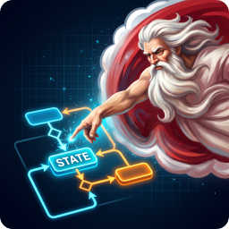
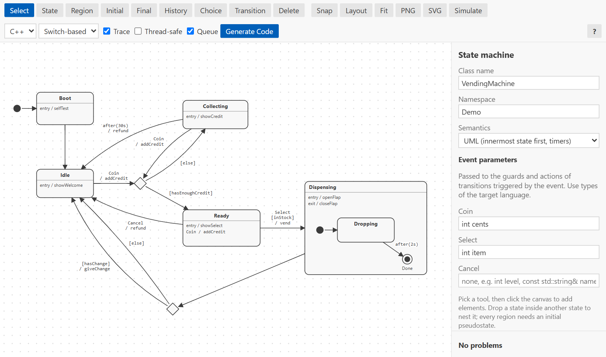
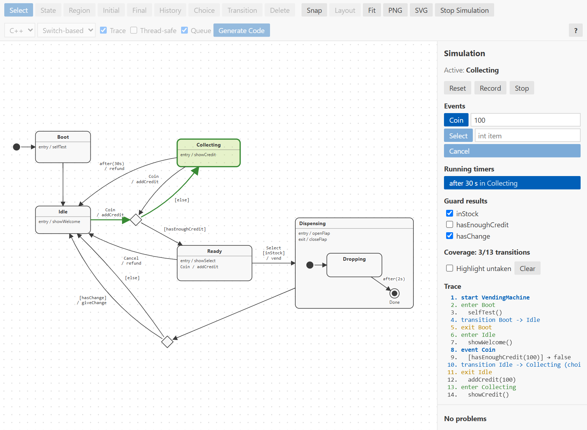

<!-- Copyright (c) 2026 JoltWare
     SPDX-License-Identifier: Apache-2.0 -->



# MachinaState

**Visual UML state machine designer for Visual Studio Code.** Draw hierarchical state machines with orthogonal regions, simulate them step by step, and generate C++, C# or C code in a switch-based or table-based style.



## Features

- **Diagram editor** for `.machina` files:
  - states, composite (nested) states, orthogonal (parallel) regions, initial and final states, history (`H`/`H*`) and choice points
  - transitions with `event [guard] / action`, internal transitions, completion transitions and `after(2s)` timeouts
  - entry and exit actions
- **Editing**: multi-selection, align and distribute, copy/paste/duplicate, snap to grid, per-element colours, draggable transition curves and self loops, and automatic layout (ELK) that spreads the diagram in both directions.
- **Simulator**: runs the same reference engine the generated code is tested against. Fire events with arguments, set guard results, let timers elapse, and watch the active states and the exit/action/entry trace. Record **scenarios**, replay them, and see which transitions are still **uncovered**.
- **Code generation**:
  - **C++17**: header-only, no heap allocation, no exceptions or RTTI.
  - **C# 8+**.
  - **C99**: a header and a source file, hooks as function pointers, no heap allocation.
  - **Switch-based** or **table-based**, both with identical behaviour.
  - Guards and actions become abstract hooks that you implement in a subclass. Event parameters are passed to the guard and action hooks.
  - Optional **trace hook**, **thread safety** through `Lock`/`Unlock` hooks, and an **event queue** for raising events from actions.
- **Stateflow import**: reads a Stateflow chart from a Simulink model (`.slx`), following library links and atomic subcharts, and keeps the chart's code for each hook. Code generation then writes a hook stub with that code.
- **Stateflow semantics** (optional, per diagram): the outer state sees each event first, states can have during actions, and `after()` counts periodic step events. Used for imported charts, and identical in the simulator and in all generated code.
- **PlantUML, Mermaid and SCXML** import and export. **Copy as Mermaid** puts a diagram on the clipboard as a ```` ```mermaid ```` block that renders in GitHub, GitLab and most wikis.
- **Problems panel** validation, **PNG/SVG export** and an optional **generate on save**.



## Documentation

The [**MachinaState User Manual**](docs/manual.pdf) (PDF) covers:

- installation and a tour of the editor
- five step-by-step tutorials, from a simple traffic light to hierarchy and history, a thread-safe C# door lock, choice points with timeouts and an event queue, and orthogonal regions
- reference chapters on the editor, modelling, execution semantics, the simulator, code generation, import/export, validation rules and the file format
- troubleshooting, and complete generated-code listings

Inside VS Code:

- **MachinaState: Get Started** opens a short walkthrough (also on the *Welcome* page).
- **MachinaState: Open User Manual** opens the manual for the installed version.
- The **?** button in the diagram editor's toolbar, or the **?** key, shows the mouse and keyboard shortcuts and the transition notation.

## Getting started

1. Install the extension (from a `.vsix`: *Extensions* view → *…* → *Install from VSIX…*).
2. Run **MachinaState: New State Machine Diagram**, or open one of the files in [`examples/`](examples). To try the Stateflow import, import [`examples/stateflow/gear_logic.slx`](examples/stateflow).
3. Draw states with the toolbar tools, then press **Simulate** to try the machine.
4. Choose a language and style, then press **Generate Code**. `<Name>.hpp`, `<Name>.cs` or `<Name>.h`/`<Name>.c` is written next to the diagram.

```cpp
#include "TrafficLight.hpp"

class Light : public Demo::TrafficLight {
  protected:
    void redOn() override    { /* ... */ }
    void redOff() override   { /* ... */ }
    // ... remaining hooks ...
};

Light light;
light.Start();
light.Dispatch(Light::Event::Timer);
```

For a guided walkthrough, see the tutorials in the [user manual](docs/manual.pdf).

## Settings

| Setting | Default | Description |
| --- | --- | --- |
| `machinaState.generateOnSave` | `false` | Regenerate the code (with the language and style stored in the diagram) whenever a `.machina` file is saved. |
| `machinaState.stateflow.libraryPath` | `[]` | Folders searched for the Simulink libraries that an imported Stateflow model links to. |
| `machinaState.stateflow.parameterFiles` | `[]` | MATLAB scripts with the values of an imported chart's parameters, such as `after()` durations and the sample time. When empty, the import asks for them. |

## Development

```bash
npm install
npm test          # compiles, runs unit, golden and interop tests, compiles/runs generated code with g++, gcc and dotnet,
                  # and runs the browser UI and Mermaid rendering tests (each skipped when the compiler or browser is not available)
npm run test:ui   # only the editor/simulator UI tests (Playwright with an installed Chrome or Edge)
npm run package   # builds the .vsix
```

- Press **F5** in VS Code to start an Extension Development Host with the examples.
- After intentionally changing a generator, run `npm run test:update` and review the changes under `test/golden`.
- The manual is built with `latexmk -pdf manual.tex` in `docs/`. `node docs/tools/build.js` regenerates its examples and code excerpts, and `node docs/tools/capture.js` its screenshots.

## License

[Apache](LICENSE) © JoltWare
